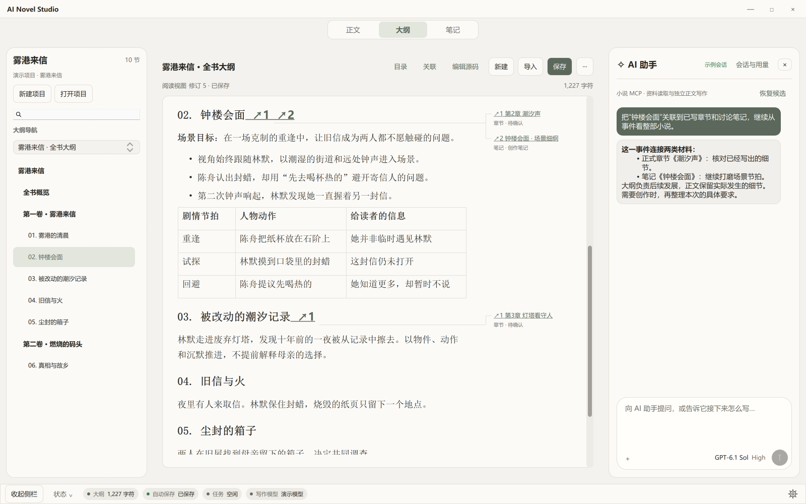
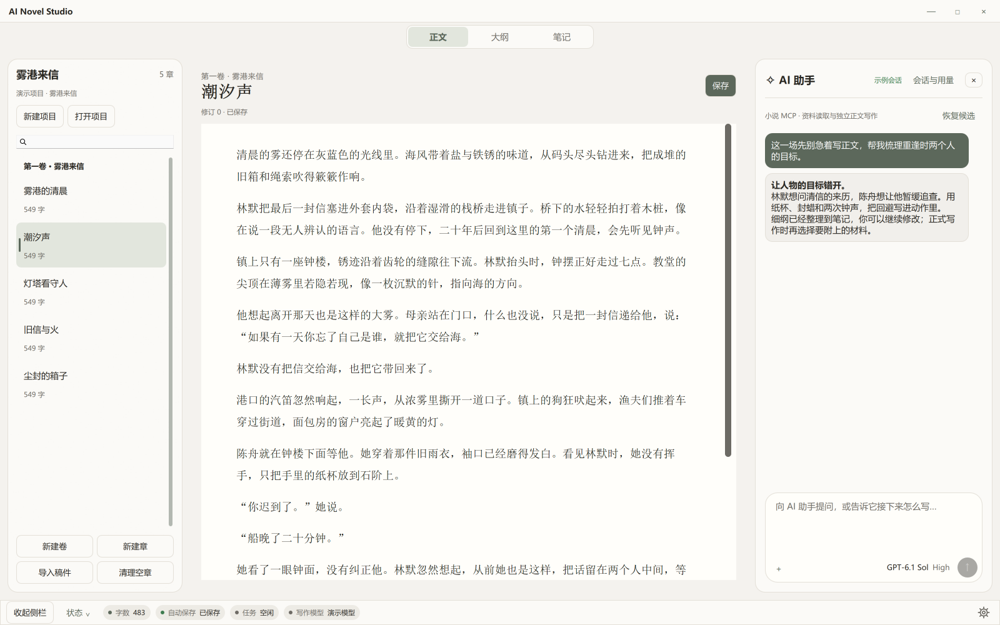
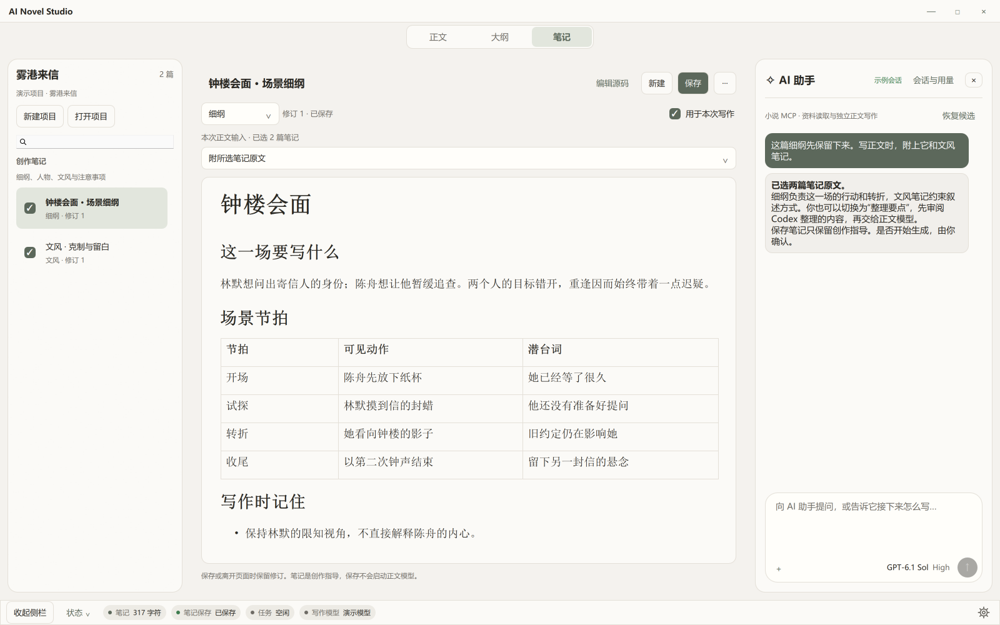
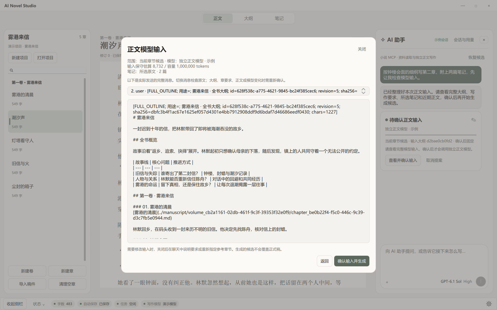

# AI Novel Studio

**简体中文** · [English](README_EN.md)

**以完整大纲驱动的本地小说创作工作台。** 在软件内与 Codex 讨论剧情，把想法沉淀为可编辑笔记，再交给独立配置的正文模型展开创作。

完整大纲 → 剧情讨论 → 场景细纲与笔记 → 确认写作输入 → 生成候选 → 审阅采用



## 为雪花式写作设计

- **从全书看一场戏。** 创作对话和正文生成以当前完整大纲为基础；需要核对细节时，通过小说 MCP 定向或批量读取正式章节。上下文超出预算时明确提示。
- **按事件自由展开。** 正文、大纲、笔记是同级工作区。Markdown 标题组织剧情，事件可关联多个章节与笔记；阅读时以标题链接和页内连线展示，改纲后保留章节链接并重新确认。
- **让讨论留下来。** 细纲、人物、文风和注意事项都能存为笔记，继续编辑、浏览和修订。每次写作可选择不附笔记、附原文，或由 Codex 整理要点。
- **每次输入都能检查。** Codex 负责讨论、查资料和整理要求，正文模型独立配置。生成前查看实际发送的完整消息，包括大纲、所选笔记与正文参考；确认后生成候选，采用时才更新正式稿。

同时保留卷章管理、Markdown／文本导入、自动保存、修订历史、范章与近期正文参考、候选预览与恢复。Codex 支持模型与思考强度、会话分支与压缩、附件和可选联网查询。

## 看看创作过程

<details>
<summary>正文与助手并排：专注阅读和编辑，在同一个窗口讨论下一步</summary>



</details>

<details>
<summary>把讨论变成笔记：保存场景节拍，并选择本次写作要附上的材料</summary>



</details>

<details>
<summary>生成前检查：看到正文模型实际会收到什么，再决定是否开始</summary>



</details>

*截图使用虚构演示项目和示例对话，模型配置为示例。*

## 安装与启动

目前为开发预览版，主要面向 **Windows**。需要 **Python 3.11+、Node.js／npm**，以及已登录的 Codex CLI 或 Codex 桌面版。

1. 克隆仓库或下载 ZIP，双击 `setup.bat` 安装依赖。
2. 首次使用时，在项目目录打开 PowerShell 构建正文编辑器：

   ```powershell
   Push-Location src/ai_novel_studio/ui_qml/editor_web
   npm ci
   npm run build
   Pop-Location
   ```

3. 双击 `启动程序.bat` 或 `launch.bat`，新建或打开项目，导入大纲。
4. 在设置中单独配置正文模型的 API 和模型；Codex 使用自身的登录。

欢迎通过 Issues 反馈问题。许可证：[MIT](LICENSE)。
