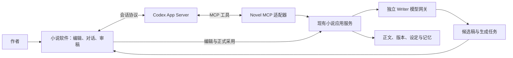

# AI Novel Studio：现有资产与 Codex 转向评估

日期：2026-10-04。状态：已完成代码盘点与有限测试；下文的新架构和工作流是实施建议，尚未接入产品。

R0 更新（2026-10-05）：旧集成工作树已完整迁存到恢复记录目录，本文的代码链接随之更新；原盘点和61项测试结论仍对应 `f82bee0`。本票恢复版位于 `codex/novel-r0-baseline`，结果另见 `R0_BASELINE_RECOVERY_2026-10-05.md`。

用户已确定的方向：放弃自研通用 agent，由 Codex 承担规划、检索决策与工具调度；用户直接在小说软件中使用 Codex；正文写作模型继续独立。旧 AGENTS.md 的主控、分工、汇报和实施流程不作为本次工作的约束。

## 1. 建议采用的产品定位

把项目收敛为“由 Codex 驱动的小说创作工作台”。Codex 负责理解意图和组织行动；软件保存小说事实、提供领域工具、调用独立写作模型，并承接编辑、审稿和正式采用。

最值得继续投入的是小说领域能力和作者界面。自研 agent 的循环、会话压缩、通用工具调度等部分停止扩展。已经实现的版本检查、证据验证、候选稿和变更提交能力继续复用，不能因为它们位于 harness 目录就整体删除。

“软件内使用 Codex”需要两条连接：软件通过 Codex App Server 驱动会话；Codex 通过 Novel MCP 调用小说工具。MCP 本身不提供完整的内嵌会话客户端。

## 2. 资产实际分布

本轮检查了主仓库、Git 分支/工作树记录、关键源码及测试，并查看了 27 个已登记工作树的受跟踪文件修改状态。没有读取实际小说项目、数据库、密钥、备份或导出，没有遍历虚拟环境和生成目录。测试使用现有 Python 可执行程序及临时小说数据。

| 位置 / 版本 | 已确认的内容 | 建议 |
|---|---|---|
| 主工作区 `main@3b3b136`，2026-08-20 | 旧 Qt Widgets 界面、小说后端及早期 Harness；产品版本号为 0.7.0 | 保留历史入口，不能把它当作全部资产 |
| `opencode/webengine-markdown-list-and-load-boundary@f82bee0`，2026-09-02 | 已整合后端、QML/WebEngine 前端、Harness、选区补丁和部分审批事务；本轮主要核查对象 | 新方向的优先候选基线，先做可运行性确认 |
| `codex/frontend-wave-f1@eb1cb61` | 较早的 QML 前端来源 | 优先复用已集成版本，避免再次重放全部前端历史 |
| `agent/ai-agent-v1@2dd9d62` | 原 Harness 的独立交付分支 | 作为资产来源；不再按原 agent 路线继续补完 |
| `opencode/muse-bridge-protocol@ba10e3c`，2026-09-04 | OpenCode 开发执行与 Codex 开发管理之间的任务/报告脚本 | 属于研发流程资产，不是产品内 Codex 接入 |
| 工作树 `b626` | 两个未提交的锁与项目打开测试文件，合计新增 314 行、删除 4 行 | 保留为未完成设计/测试素材，不计入已交付能力 |

优先候选工作区为 [集成工作区](..)。本轮测试时其受跟踪文件无修改，HEAD 为 `f82bee07b27c706da5be510629f2fd67fb034173`。

需要特别注意：`main...f82bee0` 的左右独有提交数为 **2 / 204**，不是直接快进关系。`git cherry f82bee0 main` 显示主分支的 occurrence 功能提交有等价补丁，另一个独有提交是交接文档。基线恢复仍需比较最终文件树，不能按分支日期盲目合并。

另外，`wave-a-clean` 工作树已有 `.gitignore` 修改。主工作区还有既有未跟踪的工具配置和笔记文件。本轮均未改动；工作树检查没有穷尽每处未跟踪文件。

## 3. 可以保留的核心资产

以下代码证据以集成版本 `f82bee0` 为准。“有实现”不等于本轮完成全部生产验证。

| 资产 | 代码证据 | 在新方案中的用途与成熟度 |
|---|---|---|
| 正文、章节、修订与恢复 | [chapter_repository.py](../src/ai_novel_studio/infrastructure/storage/chapter_repository.py)、[chapter_revision_service.py](../src/ai_novel_studio/application/chapter_revision_service.py) | 保留 Markdown 正文与 SQLite 元数据；已有历史版本、版本冲突检查和修订后派生数据维护 |
| 人物、正典、伏笔、认知与事件 | [domain](../src/ai_novel_studio/domain)、[shared_semantic_occurrence_service.py](../src/ai_novel_studio/application/shared_semantic_occurrence_service.py) | 作为小说长期记忆；保留事实、候选、人物认知和计划之间的区别；本轮未全面验证抽取质量 |
| 证据检索与上下文编译 | [evidence_query_service.py](../src/ai_novel_studio/application/evidence_query_service.py#L59)、[compile_context_service.py](../src/ai_novel_studio/application/compile_context_service.py#L146) | 直接作为 MCP 的核心服务；按章、来源和预算选取材料，不让 Codex 每次读取全书 |
| 独立模型网关与正文生成 | [gateway.py](../src/ai_novel_studio/infrastructure/llm/gateway.py#L38)、[prose_generation_service.py](../src/ai_novel_studio/application/prose_generation_service.py#L61) | 保留供应商路由、流式生成、用量和检查点；代码中已有独立的 `PROSE_GENERATION` 任务用途 |
| 草稿采用、审校与局部修订 | [generation_acceptance_service.py](../src/ai_novel_studio/application/generation_acceptance_service.py#L42)、[selection_patch.py](../src/ai_novel_studio/application/selection_patch.py#L108)、[changeset_service.py](../src/ai_novel_studio/application/changeset_service.py#L270) | 保留“候选与正式正文分离”、选区精确校验、差异预览和提交边界；崩溃一致性仍有缺口 |
| 已有领域查询工具 | [agent_tool_providers.py](../src/ai_novel_studio/application/agent_tool_providers.py)、[core_tool_query_service.py](../src/ai_novel_studio/application/core_tool_query_service.py#L53) | 已有章节目录、批量阅读、小说概览、人物、伏笔、正典、文风等能力；需要 MCP 协议适配，不能直接视为 MCP 服务 |
| QML 创作界面与编辑器 | [bootstrap.py](../src/ai_novel_studio/ui_qml/bootstrap.py#L214)、[WritingPage.qml](../src/ai_novel_studio/ui_qml/qml/pages/WritingPage.qml)、[editor_web/package.json](../src/ai_novel_studio/ui_qml/editor_web/package.json) | 保留章节树、编辑器、上下文侧栏、AI 时间线、差异/确认卡片；Web 编辑器使用 Tiptap/ProseMirror；优先换接运行时 |
| 测试与历史设计证据 | [tests](../tests)、[architecture](architecture) | 可用来防止资产搬迁时损坏已有行为；旧文档只作为历史证据，当前能力以源码与本轮验证为准 |

两点容易误判：

- `MockNovelStudioFacade` 名称仍带 Mock，但当前 `bootstrap.py` 已默认注入 `HarnessAgentCoordinator(HarnessAgentPort())`，包含真实项目与 Harness 接线。不能仅凭名称或 8 月的旧交付报告，把现有前端全部判为演示壳。
- 同时存在旧 `AgentLoopService` 对话工具循环和较新的 `ChapterGenerationLoop` 确定性生成链。前者适合由 Codex 替代；后者包含上下文、独立 Writer、审校和候选提交等有价值的应用逻辑，需要逐步脱离旧运行时复用。

## 4. 已确认的缺口

1. **产品接入尚不存在。** 在检查的主分支与集成版产品源码中未发现 Novel MCP 服务或 Codex App Server 客户端；主仓库的 `.mcp.json` 只配置了开发用 `repowise`。OpenCode/Codex 桥接脚本也不承担小说产品会话。
2. **当前停止按钮不负责终止模型请求。** [HarnessAgentTimelineController.stop](../src/ai_novel_studio/ui_qml/bridge/harness_agent_bridge.py#L658) 只提示后台继续运行。Codex 的中断和独立 Writer 的取消必须分别处理，并明确显示各自状态。
3. **同进程回滚不等于崩溃恢复。** [ChangeSetUnitOfWork](../src/ai_novel_studio/application/changeset_service.py#L135) 明确设置 `crash_recovery_supported = False`。已有异常回滚测试通过，不能据此声称进程崩溃或断电安全。
4. **审批记录与执行结果尚未完整合并。** [ApprovalResolver](../src/ai_novel_studio/harness/approval_resolver.py#L169) 先解决审批，再调用提交；新增 receipt 模型和 schema 不代表整条事务已完成接线。正式采用成功应以持久化结果为准。
5. **前端仍与旧 Harness 状态耦合。** 新接入需要把 Codex 会话事件映射为界面状态，但不要为了换运行时先重写整套 QML 或拆完大型 Facade。
6. **没有本轮的完整运行验收。** 原生 WebEngine/GPU 显示、真实 Codex 登录/推理、真实 Writer 供应商和大项目性能未在本轮验证。旧报告的全量通过数字不作为当前保证。

未完成测试资产见 [b626 的 recovery 测试](../tests/integration/storage/test_recovery_services.py) 和 [workspace 测试](../tests/unit/application/test_project_workspace_service.py)。它们引用了当前实现没有的锁类型，因此只列为待评估材料，本轮未运行、未补写、未提交。

## 5. 推荐的连接结构



官方将 App Server 定位为产品内嵌 Codex 的接口，涵盖认证、会话、审批和流式事件；支持 stdio。当前文档和本机帮助仍有实验性标记，因此建议本机进程接入并固定验证过的版本。[官方 App Server 文档](https://learn.chatgpt.com/docs/app-server)

Codex 的 MCP 支持 STDIO 和 Streamable HTTP。下面的服务归属和工具切分是本项目的设计建议。[官方 MCP 文档](https://learn.chatgpt.com/docs/extend/mcp?surface=cli)

建议实施边界：

- **客户端适配层：** 小说软件启动本地 App Server 子进程，管理连接、会话标识、流式展示、断线和中断。优先 stdio；保持 PySide/QML 技术栈。
- **小说工具层：** MCP 适配器调用现有 application 服务，验证结构化参数并返回有限结果。第一版可由现有应用托管本地 HTTP 端点，请求进入受控服务执行器。
- **唯一写入入口：** UI 与 MCP 复用同一个项目服务所有者和写入队列，不各自打开第二套可写项目。若后续选用独立 stdio MCP 进程，它只转发给该服务所有者。
- **独立 Writer：** Codex 组织写作任务、选择资料并提出修改；后端编译写作包，现有 Writer 网关产出正文候选。Writer 配置、凭据与用量继续独立管理。
- **领域状态：** 正文、已确认设定、角色认知、候选记忆和任务结果保存在小说项目中。Codex 会话历史承担对话连续性，不能成为小说事实的唯一存储。
- **权限范围：** 创作 Codex 使用独立的会话工作目录和创作指令，不继承开发仓库的改代码、运行终端和跨任务协作流程。直接写正文/数据库的路径必须被权限配置阻断，不能只写一句提示词；这项要在接入原型中验证。

本机已确认 `codex-cli 0.160.0` 提供 `app-server` 命令；这只证明命令可用，尚未验证实际账户、模型可用性或完整请求。登录方式和协议能力在第一张接入票中实测，不读取或复制既有凭据文件。

## 6. 第一批 MCP 能力

按创作目标提供少量工具，不把每个 Repository 方法直接暴露为工具。以下名字是建议接口，尚未实现。

| 阶段 | 工具 | 复用基础与返回内容 |
|---|---|---|
| 首批只读 | `get_workspace_context` | 当前项目、章、选区和编辑器快照身份；明确区分已保存正文与未保存编辑 |
| 首批只读 | `list_chapters` / `read_chapter` | 章节目录与有长度限制的正文读取，附来源和版本 |
| 首批只读 | `search_evidence` | 检索正文证据，返回来源、命中范围、是否截断/过期 |
| 首批只读 | `get_writing_constraints` | 当前章要求、设定、文风和相关人物状态，标记权威性 |
| 写作接入 | `prepare_writing` | 程序编译上下文包，生成不可变包标识，报告缺失资料与预算情况 |
| 写作接入 | `start_writing` | 使用已校验写作包和独立 Writer 配置，返回任务 ID |
| 写作接入 | `get_writing_job` / `cancel_writing_job` | 查询或取消独立生成任务；不会把 Codex 结束误当成 Writer 已停止 |
| 候选接入 | `get_candidate` / `propose_revision` | 候选稿、差异和提案状态；正式采用由作者界面触发 |

`start_writing` 应具备持久化去重标识，长任务快速返回任务 ID，UI 单独订阅进度。连接重试不能再次计费生成。完整稿件留在候选存储中，按需读取；工具返回不重复灌入全文和全部历史。

所有写入请求都绑定项目、目标章节、来源版本/哈希和候选身份。模型不能通过传入 `approved: true` 伪造作者确认。第一版暂不开放跨章批量修改、删除、自动人物合并或自动晋升正典。

## 7. 作者实际使用的工作流

1. 作者在软件中打开小说，编辑或选择章节，并在侧栏向 Codex 说明任务。
2. Codex 通过 MCP 获取当前状态和必要证据，形成写作任务；普通讨论可直接回答，不强制每次进入生成流程。
3. 要生成正文时，软件编译写作包。必要字段、版本、上下文预算由程序检查；资料不足时补充检索或向作者询问。
4. Codex 发起独立 Writer 任务。软件显示生成进度与候选稿；正文不会因模型完成就自动替换。
5. Codex 和已有审校服务提出意见；作者在差异界面接受、修改、拒绝或要求重写。
6. 作者采用后，后端复核当前版本并提交，随后使过期索引失效、增量更新记忆候选。持久化成功后才显示采用成功。

未来可以为批量任务增加授权范围，但首版先让一个章节的过程可靠。首个技术原型只读；第二个可用里程碑做到候选生成；正式采用作为下一段独立验证，避免再次让庞大的跨章事务设计阻塞所有进展。

界面优先保留五件事：正文编辑、Codex 对话、引用材料、候选差异、任务状态。现有人物/记忆/设定页面作为资料工作台继续使用。先减少操作分叉，不再同时扩展两套主要 UI。

## 8. 重新设计研发工作流

建议把旧的长期主控/A/B/C/多级冻结流程替换为“单一集成线、每次一个可验收场景”。

- 维护一个产品方向文档、一份短任务清单、一份当前验证记录。旧交接文档与 ADR 保留作历史，不自动转化为新阶段待办。
- 每张票写清楚用户可见结果、涉及模块、完成标准和验证结果。按“在软件内完成一个动作”切票，而不是长期分别做后端、前端、agent 三条链。
- 每张票使用短期分支，完成后审查并回到唯一集成线。开始下一张前确认上一张的结果；暂不重建长期多角色调度体系。
- 常规小改动完成实现和窄测试后直接交付；只有改变产品目标、数据格式、正式内容处理或新增收费依赖时才形成需要作者决策的事项。
- 一次集成只保留一种权威执行路径。新 Codex 路径覆盖某个场景后，再移除对应旧入口；已有历史表和记录不随运行时退役而删除。
- 对开发指令与小说创作指令分别管理。后续简化 AGENTS.md 时只保留目录边界、数据保护、关键命令和验收要求，不继续携带旧主控看板及跨任务汇报制度。

这次盘点没有修改 AGENTS.md，也没有发送跨任务消息；新工作流已经在本节形成具体建议。

## 9. 下一步票据顺序

| 票据 | 可交付结果 | 验收重点 |
|---|---|---|
| R0：确认恢复基线 | 在隔离分支以 `f82bee0` 为候选恢复单一可启动版本，核对与 main 的差异，保全未提交测试素材 | 空白临时项目可开/存/重开，QML 编辑器人工可见检查通过；不需要先合并所有旧分支 |
| R1：软件内 Codex 对话 | 复用现有侧栏，接入 App Server 的开始、继续、流式显示与中断 | 真实完成一次对话；重开软件可恢复会话；失败不显示成功；创作会话不获得开发仓库写权限 |
| R2：只读小说 MCP | Codex 能按当前章回答带来源的问题 | 三章样例可定位证据；章节切换不会串项目；未保存文本有快照标识；无正文写入 |
| R3：独立 Writer 候选 | Codex 调用现有写作模型，界面展示草稿及任务状态 | 记录证明调用了 Writer 路由；可取消；重试不重复创建任务；重新打开仍能找到候选 |
| R4：正式采用 | 作者在差异界面采用单章或选区候选 | 并发编辑拒绝过期提案；重复点击不重复提交；提交中断后的恢复结果一致；未满足前不宣称崩溃安全 |
| R5：领域扩展与旧入口退役 | 按实际写作需求逐步接入人物、伏笔、记忆审查等工具 | 每项有一个真实创作场景和回归检查；停止维护被完整替代的旧 agent 入口 |

下一张实施票建议只做 **R0：确认恢复基线**。随后用 **R1 + R2** 验证“软件内的 Codex 确实能理解小说项目”，再扩展写作能力。不要先补齐原 Harness 全部计划，也不要先做一次前端重设计。

## 10. 本轮验证与边界

实际运行位置：`<repo>/`；实际导入源码已确认来自该工作树。Python 3.12.10，pytest 9.1.1，Qt 使用 offscreen。所有模型调用由测试替身提供。

**结果：61 passed in 10.88s。** 涵盖下列六个文件：

- `tests/unit/application/test_prose_generation_service.py`
- `tests/integration/generation/test_generation_acceptance_and_recovery.py`
- `tests/integration/application/test_compile_context_service.py`
- `tests/integration/application/test_changeset_service.py`
- `tests/integration/application/test_agent_tool_providers.py`
- `tests/ui_qml/test_harness_agent_bridge.py`

复现命令（针对本次记录的本机路径）：

```powershell
Set-Location -LiteralPath '<repo>/'
$env:PYTHONDONTWRITEBYTECODE = '1'
$env:PYTHONPATH = '<repo>/src'
$env:QT_QPA_PLATFORM = 'offscreen'
$auditTestRoot = Join-Path ([System.IO.Path]::GetTempPath()) ('novel-asset-audit-' + [guid]::NewGuid().ToString('N'))
& '<repo>/.venv/Scripts/python.exe' -B -m pytest -q -p no:cacheprovider --basetemp $auditTestRoot `
  tests/unit/application/test_prose_generation_service.py `
  tests/integration/generation/test_generation_acceptance_and_recovery.py `
  tests/integration/application/test_compile_context_service.py `
  tests/integration/application/test_changeset_service.py `
  tests/integration/application/test_agent_tool_providers.py `
  tests/ui_qml/test_harness_agent_bridge.py
```

本轮不构成全量测试、真实模型验收、原生窗口视觉验收或已有小说迁移验收。未启动真实 Codex 会话、未连接 Writer、未消耗模型请求额度。唯一新增的仓库文件是本评估文档；没有修改产品代码、切换分支、提交或合并。
