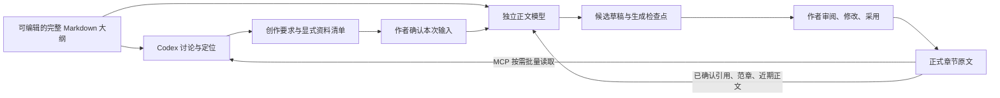

# 完整大纲驱动的小说创作流

状态：架构方案与实施路线。初评日期：2026-10-18；各票实施进度见下方记录。

实施进展（2026-10-20）：[FO-1 大纲文档与版本存储](FO1_OUTLINE_STORAGE_2026-10-19.md)、[FO-2a 可编辑大纲工作区](FO2A_OUTLINE_WORKSPACE_2026-10-19.md)、[FO-2b 轻量章节关联与确认](FO2B_OUTLINE_CHAPTER_LINKS_2026-10-19.md)、[FO-3 Codex 每轮完整大纲](FO3_CODEX_COMPLETE_OUTLINE_2026-10-19.md)、[FO-4a 正文完整输入与作者确认](FO4A_WRITER_INPUT_CONFIRMATION_2026-10-20.md)、[FO-4b 侧栏候选采用／放弃／恢复](FO4B_WRITER_CANDIDATES_2026-10-20.md)、[FO-5 默认新流程与旧入口收拢](FO5_DEFAULT_OUTLINE_WORKFLOW_2026-10-20.md)已完成实现与验证。专用 AI 关联提案入口与旧代码清理仍待后续；下文中的源码核查保留初评基线。

核查基线：已发布的 `3d196bd6f9201a1e0fcbb7171abd50be2d8a2ad6`，迁移注册至 v25。
本文替代[旧事件大纲方案](SNOWFLAKE_EVENT_WORKFLOW_2026-10-18.md)的实现方向，不实施旧方案中的事件关系网络、结构化计划库或相关性大纲筛选。

## 1. 结论与边界

方向可行，与当前桌面工作台兼容。主要调整输入组装、大纲工作区和资料传递接口，保留现有 Codex app-server、小说 MCP、独立正文网关、卷章管理、正文编辑与修订、候选检查点和恢复能力。

核心约定：**完整大纲负责计划，正式正文记录已经写出的事实，作者决定两者冲突时如何修订。**
人物、伏笔和未来发展直接保留在作者的大纲原文中，不再从正文反复抽取成创作必需的第二套数据库。
完整输入能减少资料缺失，但不能保证模型不犯错；出处可查、候选审阅和作者采用仍然必要。

- 每轮创作对话、每次独立正文生成，均使用当前完整大纲原文。
- 默认完整范围为作者登记的全书概览与全部分卷大纲，按作者指定次序组装；不能自动只取“相关卷”。
- 正文参考可以按任务选择；大纲不能按相关性裁剪、被摘要替换或静默截断。
- 层级、编号、事件顺序由 Markdown 表达，不强制固定层数或按章节顺序创作。
- 新流程稳定前保留旧项目兼容入口；不删除旧表，不启动新的 Agent Harness，不更换前端技术栈。

## 2. 当前代码的真实兼容点

下列源码路径相对于 `src/ai_novel_studio/`。结论来自静态源码与本地协议 schema 核查，未打开作者项目或运行真实模型任务。

| 当前情况 | 源码证据 | 新流程的最小调整 |
| --- | --- | --- |
| 正文主链仍自动装入旧记忆 | `application/generation_context_service.py:360`；`application/generation_memory_context_provider.py:68` | 新模式使用简单的有序输入组装器，绕过旧 provider；仅加一条大纲提示词不够 |
| 最近正文固定取目标前面最多三章，可降级成摘要 | `application/generation_context_service.py:360` | 改为作者可检查的近期章节数量与原文清单，不用摘要暗中替代 |
| 实际发送消息只处理特定类别 | `core/context/prose_prompt.py:19` | 新增来源必须进入最终 `LLMMessage`；不能只出现在 Manifest 中 |
| Codex 写作工具只有任务文本，没有正文引用参数 | `application/novel_writer_service.py:61`；`application/project_generation_session.py:184` | 增加显式章节／片段引用，后端重新读原文再传给正文模型 |
| 用户消息、文本附件和正文 instruction 有 20,000 字符限制 | `application/codex_session_service.py:279`；`application/novel_writer_service.py:61` | 完整大纲走独立输入通道；保留普通聊天和附件的既有保护，不能要求作者粘贴整纲 |
| BASIC 模式未知模型容量时使用 4,096 Token 输入预算 | `application/generation_context_service.py:165` | 新模式容量未知或不够时明确阻止任务，不沿用这个回退 |
| 已支持指定多个不连续章节，读取结果有修订与分页信息 | `application/novel_read_service.py:161` | 复用 `read_novel_chapters`，继续读至 `next_cursor` 结束；一次任务显示一个汇总状态 |
| 现有编辑器会解析并重新序列化 Markdown，加载后也发送保存快照 | `ui_qml/editor_web/src/markdown.ts:22`；`ui_qml/editor_web/src/editor.ts:220` | 大纲先用原始 Markdown 源码编辑，不直接套用正文富文本的往返转换 |
| 采用、放弃、恢复已有后端 | `application/project_generation_session.py:220` | 复用现有能力；当前 `ui_qml/qml/components/WriterTaskCard.qml:119` 只有查看、复制和停止，不能把后端存在当成侧栏已完整接通 |

`CompileContextService.compile()` 可复用部分原文证据校验；其 `build()` 会重新装入旧记忆，不能无差别复用整个旧编译流程。
证据：`application/compile_context_service.py:199`、`:242`。

## 3. 作者使用流程



1. 打开项目，载入大纲工作区；目录按 Markdown 标题生成，仅作为定位索引。
2. 作者可直接编辑 Markdown，也可从任意事件发起讨论；右侧显示本轮使用的大纲版本。
3. Codex 已收到完整大纲；需要核对政治铺垫、人物对白等细节时，按章节链接、搜索结果或作者指定读取正式正文。
4. Codex 整理创作要求，提出要交给正文模型的章节／片段清单。讨论不要求先建目标章节。
5. 发起正文创作时选择或创建落稿章节，显示输入确认卡：完整大纲版本、创作要求、相关正文、范章、近期章节及预计容量。
6. 作者确认后调用独立正文模型。生成进度、候选和操作位于聊天侧栏；采用时仍校验目标章修订，不自动覆盖正文。

确认卡是作者要求的“我确认以后”的具体入口。它不能退化为隐藏在聊天文字中的承诺。
选文润色仍限定在选区；完整大纲中的未来事件不能被当成已经发生的内容写进选区。

## 4. 大纲资产、编辑与版本

建议使用项目内的 `outlines/` 保存一份或少量有序 Markdown 文档，而不是把事件拆成数据库实体。
导入时复制作者选择的文件，保留来源文件不变；重新导入展示差异并生成新版本，不能悄悄覆盖项目内已编辑内容。

- 大纲页面具备原始 Markdown 编辑、保存／自动保存、标题导航、查找、导入和导出；预览可后续增加。
- 首版可在当前 QML 中使用纯文本编辑控件，无需引入新的富文本转换链。打开文档本身不保存、不改变原文。
- 不强制添加固定模板、事件字段或 UUID 标记；标题索引是可重建的界面数据。
- 只有正文内容实际改变才新增修订；无改动保存不使链接反复失效。
- 发送任务前先完成当前编辑保存并取得不可变快照。保存失败或外部修改冲突时明确提示，不能暗中使用旧版本。
- 每个快照保留文档 ID、修订、完整原文、长度与哈希。多文档按固定次序组成大纲包，记录整体版本指纹。
- 任务开始后冻结本次输入。生成中再改纲，不修改已发送的输入；界面提示该候选基于旧版本，下一轮使用新版本。
- 恢复生成继续使用原任务的大纲和正文快照；若作者要用新大纲，则作为新任务，不伪装成旧任务续传。

保存服务复用 `infrastructure/storage/atomic_file.py:6` 的单文件原子替换模式和正文版本校验经验，
但不把大纲假装成章节，避免触发人物、事件和章节失效逻辑。
Markdown 文件与 SQLite 元数据是两种存储，单文件原子写不代表两者跨存储原子提交；
应先保留版本快照，并在打开、发送前校验磁盘内容与登记哈希，不一致时阻止任务并恢复／重新登记，不能静默选一个版本。

## 5. 大纲与章节链接

推荐“普通 Markdown 链接 + 少量可恢复的关联元数据”。插入链接时由软件生成指向已登记正式章节文件的相对路径；
解析时再映射到稳定章节 ID。章节标题、编号、路径变化不应悄悄把链接指向另一章。
大纲某一段可关联多章，同一章也可被多个段落引用；不额外建立事件关系图。

两种建立方式：

- 手动：在大纲当前位置选择一个或多个章节，预览链接并确认。
- AI 辅助：Codex 结合完整大纲和必要正文提出“这里应链接这些章节”的建议；校验章节 ID、位置、引用修订后，作者接受才保存。模型建议本身不等于已确认关系。

**修改后重新确认的规则：**

1. 任一大纲文档内容保存为新版本，当前大纲包版本更新；原有链接及其确认历史全部保留，当前链接统一标为“待确认”。
2. 界面持续显示“修改大纲后有 N 个链接待确认”，提供差异、原链接和批量确认；不在每个按键或每次自动保存时弹窗。
3. 即使标题／编号／顺序变了，也不删除旧关系，不靠模糊匹配自动恢复为“已确认”。找不到原位置时标明“位置待定位”。
4. 作者明确删除正文中的链接时，不擅自重新插回 Markdown；历史记录保留，当前移除意图在确认界面可查。
5. 目标章节删除时标为“章节不可用”，保留原目标信息；不级联删除关联历史。
6. 确认必须针对当前大纲包版本；审查期间又改纲，旧版本的确认不得套到新版本上。确认本身只改元数据，不再次改纲造成循环。
7. AI 提案应用后生成新 Markdown 版本，再由作者确认该版本上的关系；允许同一个审阅界面完成，但不能跳过版本检查。
8. 待确认链接不参与自动定位／自动写作取材；作者仍可直接指定某章，Codex 也可依据正文搜索独立取材，但必须说明依据，不能称为已确认的大纲链接。

链接源位置可保存原版本的标题路径、原文引用和范围；这只是定位依据，不是稳定的事件身份。
首版不自动重写作者标题或强塞锚点。只有普通定位无法满足需求时，再让作者选择增加轻量锚点。
链接只解析本项目登记的章节，不自动读取任意文件路径或跟随远程 URL。

## 6. 独立正文模型的输入合同

建议新增明确的输入对象，而不是扩充一段万能 instruction。以下是待实现的数据合同，不是已有 API：

```text
OutlineSnapshot   = 有序文档原文 + 各文档修订/哈希 + 大纲包指纹
ManuscriptRef     = 章节ID + 修订 + 内容哈希 + 可选原文范围 + 用途
WriterRequest     = 目标章/修订 + 作者要求 + OutlineSnapshot
                    + related_refs + style_refs + recent_refs
```

正文任务的资料顺序固定为：

1. 完整大纲原文，含全书概览及全部登记分卷大纲。
2. 本次创作要求、目标事件／章节和已保存的作者约束；选区任务明确附选区原文与边界。
3. 显式选定的相关正式章节或片段，允许不连续章节及叙事顺序在目标之后的章节。
4. 作者手选范章／片段的原文；已有手工样本可保留，不能强制依赖旧文风自动检索。
5. 目标之前 N 章正式正文，N 可配置，展示实际清单；缺失、空章或不足 N 章应如实显示。

系统写作边界位于上述资料之前；大纲作为作者资料传入，不作为最高优先级系统指令。
多种用途引用同一正文时允许去重，但清单保留全部用途，不改写、缩短原文。

**关键接线：**

- Codex 调用读取工具只是在其会话中获得资料，不会自动给正文模型。不能让模型靠记忆复述或把所有章节粘贴到 20,000 字符的 instruction 中。
- 扩展小说 MCP 的正文任务参数／准备接口以接受显式 `ManuscriptRef`；后端校验、读取实际正文并组装最终消息。
- 相关正文、范章、近期正文均在确认前固定修订和原文范围。源文件改变时要求重新检查，不用旧范围切新正文。
- 输入确认后，存储本次大纲、任务和正文资料快照／可恢复引用，以及最终输入清单，供检查点恢复和作者检查。
- 当前候选必须匹配编辑器目标章的保护先保留；作者可先切换或新建任意落稿章，因此无需为了倒序写作去重写章序模型。
- 复用网关、流式生成、取消、检查点、采用和放弃服务。补齐侧栏的采用／放弃／恢复接线时，按已有服务校验修订；选区候选不得调用整章替换来冒充选区采用。

验收必须截获假模型适配器收到的最终消息，逐段确认原文、次序、来源与长度；只检查清单或提示词描述不算完成。

## 7. 数据库做加法，旧记忆先退主链

建议最多新增三类轻量元数据，不新增事件、故事线、人物关系或依赖图谱表：

| 拟新增 | 只负责 |
| --- | --- |
| `outline_documents` | 文档身份、项目内路径、作者排序、当前版本与内容哈希 |
| `outline_versions` | 不可变 Markdown 快照位置、版本与哈希，用于恢复与任务追溯 |
| `outline_chapter_links` | 大纲原位置／修订、章节 ID、人工或 AI 来源、当前状态、最后确认的大纲包版本及历史记录 |

前三者可分票添加；链接记录不需要成为完整大纲输入的前置依赖。多对多关系通过一段多条链接表示即可。
主文本仍是可编辑、可导出的 Markdown；数据库保存安全版本与关联信息，不保存另一套改写后的剧情。
迁移编号按实施时的集成基线分配，不在本提案预占。仅新增，不 DROP 或清空已有资料。

| 旧资产 | 新流程处置与兼容边界 |
| --- | --- |
| `characters`、`character_state_events`、`knowledge_items`、`knowledge_state_events`、`canon_entries`、`narrative_clues`、`narrative_clue_events`、`summary_nodes`、`style_rules` | 新主链不再自动读取、生成或更新；旧内容保留供查看／导出。作者计划转入大纲由作者决定，不能自动把旧摘要当成新大纲 |
| `style_samples`、`chapter_context_pins` | 保留手工资产；新模式让作者选择原文范章／片段，不沿用旧 `MEMORY/HISTORY` 类别做新输入合同 |
| `subjects`、`subject_aliases`、`view_assertions`、`character_identity_merges` 及关联审查表 | 退为旧记忆资料，停止新流程的人物投影／知识维护；暂不删表 |
| `occurrences`、`occurrence_source_ranges`、`subject_occurrence_links`、`subject_occurrence_link_source_ranges` | 保留旧正文抽取记录，停止新流程事件抽取；不拿这些表改造成大纲事件库 |
| `memory_documents`、`memory_fts`、`memory_dependencies`、`memory_embeddings` | **保留**：其中仍有正式正文分块、全文检索与版本失效逻辑，不能凭名字删除；新模式无需启用额外向量检索任务 |
| `projects`、`volumes`、`chapters`、`chapter_versions` | 保留项目、章序、正文与修订功能 |
| `chapter_requirements`、`project_guidance`、`chapter_briefs`、`brief_sources`、`context_manifests` | 作者约束继续有效；新流程不要求维护 Brief。旧生成记录仍有外键，保留历史兼容 |
| `generation_runs`、`generation_checkpoints`、旧审稿记录与配置资料 | 保留候选、恢复与旧任务的校验能力；新模式不要求先进行旧记忆审稿 |

表定义核查：`infrastructure/storage/schema_migrations_v1_to_v15.py:58`、`:79`、`:221`、`:291`、`:343`、`:608`、`:656`、`:720`、`:829`；
事件表见 `infrastructure/storage/schema_migrations_v20.py:10`；embedding 当前定义见 `infrastructure/storage/schema_migrations_v19.py:45`。

可以停止新流程调用的入口包括 `GenerationMemoryContextProvider.blocks`、`PlotMemoryContextService` 的摘要选择、
`MemoryAnalysisService`、`MemoryCandidateIngestService`、`ViewAssertionBatchExtractionService` 和 `SharedSemanticOccurrenceBatchService`。
这是停止新流程调度，不表示这些功能当前全都会在打开项目时自动运行。

有两条不能误切断的调用链：

- `application/manuscript_memory_build_service.py:154` 先维护正式正文索引，`:177` 之后才做摘要／模型抽取；保留前一类职责，停后一类，不能整个删除后失去搜索。
- `application/chapter_revision_service.py:778` 与 `infrastructure/storage/search_repository.py:500` 维护正式正文分块；`chapter_repository.py:613` 保存时仍会使旧原文索引失效，默认还会使旧视图与事件过期。先保留这些安全维护；后续另票解耦，不能用关闭所有失效来掩盖过期数据。

## 8. 长上下文、缓存和 Codex 会话

采用简单容量检查，不引入新的记忆排名：系统／工具定义、完整大纲、会话历史、选定正文、附件、输出预留和安全余量全部计入。
容量未知应要求配置／确认实际模型容量；容量不足展示各部分占用并停止发送。
作者可减少可选正文、调整近期章数或换用容量足够的模型；软件不能自行缩纲、只留相关卷、降级为摘要或偷偷压短范章。
当前字节数除以四的估算不能当作中文精确 Token 数，估算误差和服务端拒绝要明确处理。

完整大纲独立于普通消息和附件的长度限制。发送前后记录长度／哈希，测试开头、中间、末尾内容均抵达最终请求；
同时检查传输边界：当前 `infrastructure/codex/app_server.py:284` 对一条 stdout 帧限制 8 MB，长输入回显和历史读取也可能触发，不能只扩大出站字符串。

Codex 首选沿用已有 `turn/start.input` 文本输入，每个新的创作轮次追加当前完整大纲快照与本轮要求。
本地协议的 `TurnStartParams` 有 `input`，但没有可假定存在的每轮 `baseInstructions`／“固定不可压缩资料”字段；不能设计不存在的接口。
旧版本大纲留在历史中时，以本轮明确标出的当前版本为准，界面仍可追溯旧任务。
新模式同时更新 `application/codex_session_service.py:27` 的助手规则和写作 skill：以完整大纲、作者约束与正式正文为默认依据，先准备输入供作者确认，再开始生成。
旧人物记忆工具仅留兼容入口，不再作为新模式默认提供的创作资料；是否允许生成由后端确认状态校验，不能只靠提示词约定。

反复携带大纲会占用会话容量，缓存不会消除这一点。官方 app-server 支持 `thread/compact/start` 并提供压缩事件，
但这不构成“完整大纲永不被压缩”的保证。实施时必须验证自动／手动压缩后的行为：下一轮重新注入原文；
若活动任务内发生压缩，需在继续创作前通过已验证的协议补入完整快照，否则中断并明确提示，不能把历史摘要当成完整大纲继续写。
若当前运行时无法满足该保证，该边界应阻止新模式验收，而不是宣称已支持。
来源：[OpenAI Codex App Server 文档](https://learn.chatgpt.com/docs/app-server)。

缓存作为后续优化：固定系统规则和完整大纲顺序，避免在可复用前缀前插入变化的时间戳／任务编号；
在具体供应商支持的协议上测试缓存并观察用量，不保证 Codex 登录通道与兼容 API 有相同参数或命中率。
它只能减少重复前缀的处理成本，不能代替完整输入或突破上下文窗口。
来源：[OpenAI Prompt Caching 文档](https://developers.openai.com/api/docs/guides/prompt-caching)。

## 9. 渐进实施票

每票只处理自身边界，必要时继续拆小；独立正文与 Codex 完整输入均通过后，才把新模式作为默认。

| 票 | 实施内容与可复用依据 | 验收重点 |
| --- | --- | --- |
| FO-1 大纲文档与版本 | 独立大纲存储／服务；先加文档、版本元数据。参考 `atomic_file.py:6`、`chapter_repository.py:543` 的原子写与版本检查，不调用章节保存逻辑 | 导入／重导入、无损原文、版本冲突、保存失败恢复、未改动不增版本；只用临时测试项目 |
| FO-2a 可编辑大纲工作区 | 已完成 QML 源码编辑、保存、标题导航、导入导出与版本操作；采用独立 bridge | 无固定层级；打开不自动改写；未保存编辑与预览操作受版本保护 |
| FO-2b 轻量章节关联 | 已完成普通 Markdown 章节链接、手动插入、关联面板与确认历史；只增 v27 关联表 | 改纲／重排后保留旧关联并批量重确认；旧版本确认失败关闭；专用 AI 提案接线仍待后续 |
| FO-3 Codex 完整大纲 | 已完成每轮完整原文、已确认章节 ID 清单、容量／传输保护、侧栏版本摘要与发送前保存 | 27,296 字虚构大纲通过真实 Codex 新建／改纲／恢复／分支／手动压缩后验收；运行中自动压缩真实触发并停止 |
| FO-4a 正文完整输入与确认 | 已完成显式章节／片段引用、整纲原文、有序组装、人工范章、近期正文、作者确认及实际模型接线；复用网关、generation run 与检查点 | 最终适配器请求与审阅逐条一致；未知／超预算拒绝；资料／路由／章序变化重确认；新模式不调用旧记忆 provider |
| FO-4b 候选审阅与恢复操作 | 已完成侧栏采用、放弃、恢复及原输入预览；复用精确选区、正文修订与检查点 | 重复选文只修改原范围；原文／修订／检查点变化拒绝采用；恢复不重新生成；正式正文与采用状态同事务提交 |
| FO-5 默认新流程与旧入口收拢 | 已默认完整大纲与作者确认；缺纲明确阻止正文任务；默认不建旧 Harness、移出旧人物工具；旧资料收为只读 | 旧项目可开、编辑与查询；登记后完整创作闭环；旧技能保留并禁用；历史审查拒写；正文索引与修订不受影响 |

**FO-1 至 FO-5 的核心闭环已完成。** 下一票建议做整体验收与集成；专用 AI 章节关联提案和旧代码清理独立排期，保留旧资料与正文索引。

后续验收至少包含：

1. 用带编号、任意层级、中文、重复标题、普通链接的大纲验证原文保存与完整注入；大纲末尾放唯一标记检查截断。
2. 改纲、重排标题、删除标题、重导入、AI 建议、章节改名／删除都保留旧关联并要求作者确认。
3. 连续两轮、恢复会话、分支及压缩后仍有本轮完整大纲；同时测试容量不足、未知容量和传输上限。
4. 用不连续章节、人工范章和近期正文验证独立模型的实际消息；修改源章节后禁止使用过期修订／范围。
5. 选区润色不扩大为整章；作者未确认不开始写作；未采用候选不覆盖正式正文。
6. 取消、重启恢复、旧任务采用／放弃和旧项目全文搜索仍然可用；新模式不调用旧记忆提取器。

本票只核查方案与文档链接／路径，不据此声称以上功能已完成或通过运行验收。
