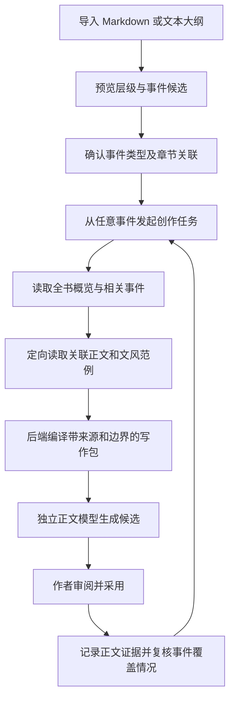

# 事件大纲驱动的雪花式创作流

状态：已被[完整大纲驱动方案](FULL_OUTLINE_WORKFLOW_2026-10-18.md)替代，保留供历史参考。日期：2026-10-18。

后续以作者要求的完整大纲原文、按需正文和轻量章节链接为主，不再实施本文的事件关系网络、结构化计划库或相关性大纲筛选。本文中的实施票不再作为当前开发计划；尚未实施数据库迁移。

核查基线：`codex/novel-chat-writer@93ca353`。本票交付创作流、数据关系、接线方案与实施票。
用户已确认：现有大纲为带编号、标题和层级的 Markdown／文本。

## 1. 推荐方向

以事件大纲组织创作，以章节保存正式正文，以原文证据维护记忆。

作者可以从任意事件开始讨论、展开或落章；一个事件可分布在多章，一章也可承载多个事件。
章节尚未安排的事件仍可存在。正文事实、作者计划、人物认知与读者已知信息分别管理。

雪花式展开支持“一句话构思 → 全书梗概 → 故事线／阶段 → 事件 → 场景 → 正文”，
但不强制作者补齐固定层数，也不要求把现有大纲改写成模板。先按现有文档建立层级，再逐步补充细节。
雪花法原作者说明从概括向场景和正文展开，也允许写作中修订设计文件；本方案据此适配用户的事件大纲。
来源：[Randy Ingermanson 的雪花法说明](https://www.advancedfictionwriting.com/articles/snowflake-method/)。

这套结构需要区分三个顺序：

| 顺序 | 用途 | 例子 |
| --- | --- | --- |
| 故事发生顺序 | 检查因果、人物状态与事件前提 | 幼年经历先发生，宴会试探后发生 |
| 叙事呈现顺序 | 控制读者何时得知、伏笔何时揭示 | 幼年经历可能在后半部以回忆呈现 |
| 实际创作顺序 | 记录作者工作与版本历史 | 先写结尾，再补中段 |

大纲编号、章节显示编号和创建时间都不能充当事件身份。依赖关系帮助取材与检查逻辑，不强迫作者按依赖顺序写作。

## 2. 已有资产与实际缺口

下列路径相对于 `src/ai_novel_studio/`，结论来自源码静态核查。

| 资产 | 证据 | 复用方式／边界 |
| --- | --- | --- |
| 作者计划查询 | `application/plan_query_service.py:48` | 已明确标记 `AUTHOR_PLAN`，目前只聚合当前章要求和全书指导，尚无事件大纲树 |
| 章节写作简报 | `application/chapter_brief_compiler.py:34`、`domain/generation.py:128` | 已有必须事件、人物、认知、伏笔、禁止改动、文风和来源指纹；当前必须事件主要来自章要求文本 |
| 正文抽取事件 Occurrence | `domain/occurrence.py:67`、`:226`、`infrastructure/storage/schema_migrations_v20.py:10` | 记录模型从正文抽取的事件及证据；模型来源和同章证据范围有严格约束，适合连接已落章事实 |
| 正文批量读取 | `application/novel_read_service.py:147` | 可按章节 ID 批量读取，包括指定的后文；复用分页和完整性标记 |
| 现有历史检索 | `application/novel_read_service.py:232`、`core/context/history_retriever.py:89` | 依赖 `before_chapter_id`；事件规划需要额外的显式范围，不能仅删除旧过滤条件 |
| 原文证据与上下文清单 | `application/compile_context_service.py:146`、`core/context/context_manifest.py:29` | 已有正文修订、哈希、范围、来源和预算记录，可用于事件写作包 |
| 文风规则与人工范例 | `core/context/style_retriever.py:30` | 已按全书、场景类别、人物、章节取材；事件包应继续使用经过审查的范例 |
| 认知和揭示边界 | `domain/view.py:10`、`application/view_assertion_context_provider.py:33` | 已区分世界事实、人物认知、读者已知、作者计划；现有可见性主要定位到章节叙事序 |
| 正文修订与失效维护 | `application/chapter_revision_service.py:389` | 复用修订影响处理，增加事件证据与写作包的依赖失效 |

需要落实的三项关键接线：

1. `application/novel_writer_service.py:61` 的 `NovelWriterService.generate` 目前要求目标等于编辑器当前章，`_generate` 以 BASIC 模式调用章节生成。
   Codex 的主要写作输入是 `instruction` 文本；聊天中读过的章节不会自动进入独立正文模型。
2. `application/generation_context_service.py:272` 的 `GenerationContextService._blocks` 默认选择目标章之前最近三个非空章节。
   这可以作为旧项目的兼容策略，事件模式应按事件关联资料选择上下文。
3. `application/project_generation_session.py:116` 的构造接线尚未注入 `CompileContextService`，
   `prepare_generation:184` 尚未传入 `evidence_needs`；即使证据块已编译，
   `core/context/prose_prompt.py:19` 当前也没有序列化 `exact_evidence` 类别。
   验收必须检查实际发送给正文模型的消息，不能只检查检索结果或 Manifest。

当前工作树迁移注册到 v25，主目录 `main@3b3b136` 注册到 v23。
实施时先冻结集成基线，再按该基线分配下一个迁移编号；本提案不预占 v26，也不把版本号差异当作可直接合并的证据。

## 3. 创作流



### 3.1 导入与保留原稿

1. 原始文件作为不可变导入快照保存，保留原始字节、编码、换行、哈希和版本。
   外部文件仍由作者管理；软件中的工作大纲成为确认后的结构化版本。再次读取外部文件走“重新导入／比较差异”。
2. 确定性解析 Markdown 标题、所选编号规则和缩进。代码围栏内的标题按正文处理。
   序言、人物备注、未识别段落均保留，先作为普通节点／备注；导入预览允许批量指定“哪一级是事件”。
3. 节点种类建议为概述、故事线、事件、场景、备注。不把每个标题都自动认定为剧情事件。
4. 支持从正文中的“关联章节：第12章《宴会》”或 Markdown 章节文件链接提出关联候选。
   章节标识最终解析为本项目的稳定 UUID；重名、缺章、跨项目路径和模糊编号显示待确认。
   软件不因导入大纲自动创建章节，也不自动打开外部链接。
5. 人工确认后统一写入。模型可辅助提出摘要、分类和关联建议，结构化结果须校验，确认前保留候选状态。

已有大纲不必包含新字段。事件卡可逐步补充：剧情目的、前提、参与人物、冲突、转折、结果、
必须保留的细节、不可提前揭示的信息、视角、预期文风和关联章节。

### 3.2 非顺序创作

作者可以说：“先写宴会试探这个事件，保留身份悬念，参考已写的对话风格。”

- Codex 先定位该事件及其所在故事线，识别同名事件、前提和计划结果。
- 后端优先选择作者确认的章节关联、证据关联与人工参考，再按需要补充正文检索。
- 前置情节尚未写成正文时，将其标记为“作者计划中的前提”；独立模型可以据此起草当前事件，
  但这些前提不自动变成已经发生的正文事实。
- 第一版继续复用章节生成与候选存储。生成正文前选择任意目标章节，并在软件中打开它；
  不要求先完成之前章节。尚未安排章节的事件可以继续规划和细化场景。
- 未绑定章节的独立事件正文草稿，涉及当前 `GenerationRun.chapter_id` 等持久化约束，留作后续单独设计，
  不通过隐藏创建空章或伪造当前章节来绕过约束。

### 3.3 大纲、正式稿和记忆的关系

事件卡同时呈现“计划写什么”和“目前正文写成什么”，每项差异指向原文证据。
同一事件可关联第12、13章；第12章也可关联另一个铺垫事件。

记忆库增加事件视图：从事件进入关联人物状态、认知、正典、伏笔和正文片段。
底层证据仍保留章节 UUID、修订、哈希与范围，用于定位、审查和失效判断。
跨章事件由聚合视图连接多个正文 Occurrence／证据，不合并丢失其来源身份。

进度至少区分：规划中、已有候选、部分落章、已核对覆盖、待复核。
“已生成候选”“已采用正文”“事件已完整实现”是三个不同结论。
模型可以建议覆盖情况，作者确认且证据有效后才显示已核对覆盖。

### 3.4 大纲调整与反向修订

- 修改事件、调整顺序、拆分或合并事件时，预览受影响的关联章节、计划前提、候选稿和证据。
- 编号与标题变化不会改变节点 ID；章节改名、调卷和重新编号也不会丢失关联。
- 删除或归档事件后保留其旧版本、关联历史及已有正文，显示“正文已脱离当前计划”等待处理的差异。
- 修改正文后允许提出“同步调整大纲”的建议，采用前不自动覆盖作者计划。
- 不以模型相似度或“任务成功”作为自动确认事件完成的依据。

## 4. 大纲优先的检索与正文写作包

### 4.1 分层阅读

默认顺序为：全书简版概览／故事线地图 → 目标事件及必要邻接节点 → 关联正文 → 精确细节与文风范例。
作者讨论全局时可以读取完整大纲；长大纲先提供上层概览与分页事件索引，按目标下钻。
“先读大纲”不等于每轮将大纲全文重新发送，也不意味着看过提要就宣称读完全部细节。

推荐选择优先级：

1. 作者明确指定、当前选文、目标事件、锁定章要求与必要上下文。
2. 已确认章节关联和事件实现证据。
3. 事件前提、铺垫／回收关系、同一人物线及人工固定参考。
4. 正文检索用于补漏；需要连续叙述时补充相邻原文。
5. 经过审查的全书／人物／场景文风规则与少量原文范例。

事件关联不完整时明确报告缺口。搜索、语义匹配或模型建议提供候选，不冒充作者已经确认的关联。
先提供精确片段和必要邻段，确需整章时使用现有批量正文读取；始终保留分页、截断和未读范围信息。

### 4.2 作者全局阅读与当前正文可写范围

作者侧 Codex 可以了解结局和未展开事件。正文模型使用面向本次任务的资料投影：

| 内容 | 写作包中的用途 |
| --- | --- |
| 目标事件及当前允许发生的计划 | `AUTHOR_PLAN` 写作要求，可据此创作，尚非正式稿事实 |
| 有来源的既有正文与确认设定 | `FORMAL_MANUSCRIPT`／已确认事实，注明来源与修订 |
| 尚未落章的必要前提 | 标注未落章的计划前提，避免假称已有正文支撑 |
| 人物与读者认知 | 按目标叙事位置和视角限制，未知不自动补成已知 |
| 后续剧情与隐藏真相 | 仅提供本次确实需要的幕后约束，控制正文可披露内容 |
| 文风规则和范例 | 约束表达方式，不能替代情节事实证据 |

导入文件是作者材料，不直接升级为系统提示或正式记忆。
现有视图过滤继续约束已确认事实；新计划层作为任务指令进入正文上下文，不能简单混入普通事实池。
未安排章节的事件没有可靠的旧章节可见性序号，应保留未知状态或使用明确的事件计划边界，不能猜测数字映射。
细化到场景／事件的揭示边界应另加稳定节点锚点，再投影到已安排的叙事位置；旧视图记录无需一次性重写。

文风一致需要规则和实际范例。默认选择经过作者确认、适合当前视角／场景的材料。
后文章节范例仍可能携带尚未揭示的情节，不能仅标注“只参考文风”就跳过内容可见性检查。
生成后继续审查情节、认知和表达偏差；大纲检索本身不构成一致性保证。

### 4.3 后端编译资料包

建议引入轻量的事件写作上下文请求与不可变资料包，复用 `ContextBuilder`、`ContextManifest` 和生成准备链。
这属于现有上下文链路的扩展，不另建 agent 调度系统。

资料包应包含：

- 本次任务、目标事件 ID 与修订、目标章与预期修订、当前选文及来源。
- 全书简要定位、事件目的／前提／结果、硬要求、可发挥空间和披露边界。
- 所选正文及准确来源、有效人物状态／认知、伏笔信息、文风规则和范例。
- 所有实际使用节点、章节、证据与规则的身份、版本、哈希、选择理由、预算及省略理由。

执行顺序：Codex 提出目标和取材意图 → 后端解析并验证引用 → 按权限、视角、叙事边界和预算编译 →
正文模型接收实际消息 → 任务卡显示候选与来源摘要。
关键约束超出预算时应缩小范围或要求补充选择，不静默丢弃。

事件模式采用 `EVENT_GUIDED` 资料选择策略；未配置事件大纲的项目继续使用兼容的章节策略。
事件模式按所选资料包组织近期正文和历史证据，避免再无条件叠加“前三章全文”。

Manifest 必须与实际模型消息一致。新增计划类别和现有 `exact_evidence` 类别都需要在最终序列化器明确输出，
并验证最终输入预算；不接受“清单有记录，但正文模型没收到”的实现。
资料包 ID 按项目与本轮任务隔离，来源版本在生成和采用时检查，过期候选保留并提示复核。
冻结本轮选文与上下文的既有行为继续适用。

### 4.4 MCP 能力增量

以下名称均为提案，当前没有这些新工具：

| 提议接口 | 职责 |
| --- | --- |
| `get_outline_map` | 当前工作大纲版本、全书概览、分层节点索引、分页与覆盖信息 |
| `read_outline_nodes` | 按 ID 或查询定位节点，返回原文、父级摘要、已确认章节关联及歧义候选 |
| `prepare_event_context` | 按事件、目标章和阅读目的，定向选取资料并返回临时写作包及来源预览 |

`generate_novel_draft` 后续增加可选的资料包引用。后端重验其项目、目标章和版本，而非信任模型传入的任意正文。
大纲导入、更新、链接确认等持久化写入仍由应用服务所有者处理；不向 Codex 开放任意 SQL／路径写入。
工具扩展时同步更新服务端注册、`NovelReadService` 能力声明、客户端允许工具集合和相应测试，避免新增工具后连接校验失败。

聊天只显示一个可展开的资料汇总，例如“已读大纲6个事件、关联正文4章、文风参考2段”。
中间工作区承载大纲编辑和关联检查，右侧聊天保持紧凑；左侧可切换“大纲／章节”。

## 5. 数据库的增量适配

继续使用项目内 SQLite。第一阶段新增五类权威表，后续按功能增加关系与实现证据；下列为建议模型，非已执行 DDL。

| 建议表 | 主要字段与职责 |
| --- | --- |
| `outline_documents` | 稳定文档 ID、名称、当前导入版本、树版本；标识一个工作大纲 |
| `outline_document_revisions` | 文档 ID、修订、原始字节、编码、原文哈希、导入时间与解析策略版本；保留不可变原稿 |
| `story_plan_nodes` | 稳定节点 ID、所属文档、父节点、节点类型、排序、显示编号、当前节点修订、归档状态 |
| `story_plan_node_revisions` | 节点 ID＋修订、标题、原文内容、可选摘要、任务约束、来源版本／范围、内容哈希、来源类型与审查状态；保存独立历史 |
| `event_chapter_links` | 节点 ID、章节 UUID、关联角色、关联修订与确认状态；实现多对多，角色可为主场景／铺垫／回收／提及 |
| `plan_relations`（后续） | 稳定节点之间的因果、前提、铺垫、回收等关系及修订；用于导航、影响分析和逻辑检查 |
| `event_realizations`（后续） | 计划节点修订、章节 UUID、正文修订／哈希／范围、可选 Occurrence 引用、核对与失效状态；保存已写证据 |

节点参与人物先复用已有稳定角色／Subject 身份；未能确定的名称保留为计划材料或待关联候选。
按人物线的高频关系查询确有需要时再加专用关联表。原有状态、正典、伏笔、视图断言和 Summary 不迁入计划表。

### 5.1 身份、约束与索引

- UUID 是关系身份；`2.3.1`、章节名称、文件名和内容哈希都不是主键。
- 父节点和关联目标必须属于同一项目；层级结构不能成环，节点修订使用 CAS。
- 当前工作节点只指向作者确认的版本；模型提出的修改保留来源与候选状态，经作者采用后才切换工作版本。
- 因果／前提关系与层级关系分开。语义上的循环可能是有意设计，应提示作者检查，不一律当作数据损坏。
- `event_chapter_links` 按节点和章节建立双向索引，并约束同角色关联不重复。
- 不在链接里复制章号；显示时按章节 UUID 读取现名与当前排序。章节删除／节点归档后保留历史并显示失效关联。
- 每条实现证据绑定源修订、哈希、精确范围；检索缓存或正文块 ID 不能替代持久证据身份。
- 计划查询使用明确的 `AUTHOR_PLAN` 范围。派生全文索引可沿用现有 SQLite 检索模式，
  但不能让计划条目通过旧事实检索默认进入正文记忆。第一版优先稳定 ID、标题与确认关联，无需新增向量数据库。

### 5.2 重新导入与局部失效

新导入先产生差异预览，再提交新版本。相同文档与相同原稿重复导入应幂等。
既有节点优先按已确认身份对齐；无显式身份、重复标题、结构大幅调整等情况提供匹配候选，确认前不搬移链接。
可在“导出副本”中携带稳定节点标记，源文件由作者决定是否替换。

在软件中编辑过的大纲再次导入时，应比较旧导入快照、外部新文件和当前工作节点，保留本地修改并报告冲突。
仅有匹配建议或文本相似度时不自动合并事件、删除节点或重新绑定章节。

节点修改只影响实际依赖它的计划子项、链接、Brief 和写作包；全书树版本用于刷新导航，
不会单凭树版本变化使所有正文记忆失效。正文修订则通过已有 RevisionImpact 扩展到关联实现证据。
现有正式稿、人物数据和已确认记忆不因导入或调整大纲而自动改写。

## 6. 实施票与验收

Phase 0（本票）已完成源码核查及提案。后续票按选定集成基线顺序实施；表结构与公共接口在对应票冻结后开发。

| 票 | 交付 | 复用／修改位置 | 验收重点 |
| --- | --- | --- | --- |
| SF1：大纲解析与只读预览 | Markdown／编号文本 → 保留来源范围的层级节点候选；可指定事件层级 | 新增小型领域 DTO、纯解析模块与预览服务；不走 `ManuscriptImportService` 的正文写入流程 | 全文可回溯；代码围栏、重复标题、中文编号、CRLF、BOM、异常编码、大文件和歧义有明确结果；不调用模型／写库 |
| SF2：版本与关联存储 | 五张核心表、仓储、确认导入／重导入、章节双向链接 | 遵循 `schema_migrations.py` 注册模式与现有仓储 CAS；专用大纲应用服务 | 临时旧版本项目迁移、失败回滚、外键／同项目约束、重复导入、编号变化仍保留 ID、历史可读；不批量重建旧记忆 |
| SF3A：导入和事件工作区 | 导入预览、确认、事件卡、章节关联和打开目标章 | QML 页面与 Facade 薄接线；前端在专用工作树实施 | 一事件多章、一章多事件、未关联事件可保留；原文件不被覆盖；右侧聊天可用空间保持充足 |
| SF3B：大纲只读 MCP | 地图和节点查询、版本／分页、事件与正文来源说明 | 扩展 `NovelReadService`、MCP 注册、允许工具集合 | 中文事件查找、同名歧义、跨项目 ID 拒绝、分页完整性、关闭项目撤销旧工具 |
| SF4：事件写作包贯通 | 定向正文／文风取材、临时包引用、独立 Writer 真实接线 | `ProjectGenerationSession`、`GenerationContextService`、`CompileContextService`、`prose_prompt`、`NovelWriterService` | 检查实际 gateway 消息包含选定事件、精确原文、文风和边界；不默认叠加前三章；预算与来源清单一致；旧模式兼容 |
| SF5：事件证据与影响分析 | 计划关系、已写证据、按事件记忆视图、改纲／改章复核 | `plan_relations`、`event_realizations`、RevisionImpact、既有审查服务 | 生成候选不等于事件完成；改章证据过期但历史保留；改纲只影响依赖项；计划不得自动升为事实 |

SF4 必须包含以下行为验收：

1. 全书后半部某事件关联两个已写章节，其中一个位于当前目标章之后。
   作者侧可定位并阅读；正文侧依据本次叙事边界选材，不能仅按文件写作时间判断可见性。
2. 前置事件还没写成正文，当前事件仍可根据明确标记的作者计划起草。
3. 一个独特细节仅存在于指定正文片段；另一个计划指令仅存在于目标事件。
   fake gateway 捕获的最终消息必须同时包含正确材料，且没有被省略的隐藏揭示。
4. 只保留 Manifest 证据记录而漏掉最终消息内容的实现必须测试失败。
5. 大纲或目标章在编译后修改，采用前能识别过期；不覆盖正式稿，不删除旧候选。

测试只使用新建临时项目及模型替身；阶段性真实调用再单独使用短测试文本，验证实际资料传递。

## 7. 下一票 SF1 的具体边界

建议先完成“导入 → 层级预览 → 指定事件层级”，用纯数据证明用户现有文件能够被正确承接。

拟新增文件（尚未创建）：

- `src/ai_novel_studio/domain/story_plan.py`：导入候选节点与来源范围 DTO，明确候选临时键与正式 UUID 的区别。
- `src/ai_novel_studio/core/planning/outline_parser.py`：纯解析器，保留原文和范围，输出节点及诊断。
- `src/ai_novel_studio/application/outline_import_preview_service.py`：有上限的文件读取、严格解码、解析策略与预览结果。
- `tests/unit/core/test_outline_parser.py`、`tests/unit/application/test_outline_import_preview_service.py`：手写小样例、范围与无副作用验收。

解析结果只描述原文件。叶节点、备注、章节链接和编号层级可提出候选，不凭模型把作者原文重写成事件事实。
自动语义摘要和人物／因果抽取不是 SF1 的前置条件。最终导入确认和稳定身份落库由 SF2 负责。

SF1 的预期窄测命令：

```powershell
$env:PYTHONPATH = Join-Path (Get-Location).Path 'src'
$env:PYTHONDONTWRITEBYTECODE = '1'
$taskTemp = Join-Path $env:TEMP ('outline-preview-' + [guid]::NewGuid().ToString('N'))
python -m pytest tests/unit/core/test_outline_parser.py tests/unit/application/test_outline_import_preview_service.py -q -p no:cacheprovider --basetemp $taskTemp
```

上述测试文件和命令属于后续票，本票没有宣称已执行这些尚不存在的测试。

## 8. 方案取舍

| 方案 | 取舍 |
| --- | --- |
| 每轮把大纲全文塞进最高系统提示 | 实施快，但版本、预算、来源、局部阅读及披露边界都难维护，不作为持久方案 |
| 把原有记忆表整体改成按事件存储 | 会丢失修订证据定位并牵动现有查询；改用事件聚合入口，继续保留原文来源 |
| 直接放宽 Occurrence 来保存计划 | 会改变既有模型来源和正式稿证据契约；新增计划节点并与 Occurrence／原文证据建立关系 |
| 一次新增图数据库和完整场景原生生成框架 | 超过当前需求；先用 SQLite 层级、多对多链接及现有生成链打通可验证闭环 |

本提案的核心验收是：作者从事件进入任务，Codex 据大纲定位资料，独立正文模型确实收到经过编译的相关原文和约束，
结果可追溯到大纲版本与正式正文，而实际写作顺序仍由作者决定。
